# Jarvis

Jarvis is an offline-first AI assistant for Windows. It runs local Ollama models for everyday work and TUKI technical tasks, with voice controls, a weekly planner, document search, and a coding workspace with reviewable edits. Local tools work offline after setup. Web search and other online services require separate configuration.

Download the Windows source ZIP and checksum from [Jarvis v1.3.0](https://github.com/test3457890/Jarvis/releases/tag/v1.3.0). See the [release notes](docs/ReleaseNotes.md) for what changed and the [capability matrix](docs/Capabilities.md) for requirements and testing status.

[Install Jarvis](#install-once) · [First launch](#first-launch-setup-wizard) · [File tasks](#file-tasks-in-selected-folders) · [Jarvis and TUKI](#jarvis-and-tuki) · [Project NOMAD](#project-nomad-integration) · [What is in this repository](#what-is-in-this-repository)

See [CHANGELOG.md](CHANGELOG.md), the [capability matrix](docs/Capabilities.md), the [HUD control report](docs/ControlReport.md), the [architecture guide](docs/Architecture.md), the [defensive security model](docs/Security%20Model.md), and [third-party attribution](docs/Third%20Party%20Attribution.md).
For future features, full status tracking, and session handoffs, see the [master development plan](docs/Master%20Development%20Plan.md), the [consolidated development tracker](docs/Development%20Tracker.md), the [44-item status audit](docs/Roadmap%20Status.md), and the [engineering handoff](docs/Engineering%20Handoff.md).

For the November 2026 owner/Claude hardware pass, use the [Windows verification checklist](docs/Windows%20Verification.md).
Automated HTTP/model fixtures and existing screenshot examples do not establish
real Ollama, NOMAD, audio, image-generation or Windows hardware behavior.

## Screenshots

[View all 18 legacy screenshots](docs/screenshots/README.md). See the separately labeled [original design concepts](docs/design-concepts/README.md). Includes the planner, setup, mobile layouts, and control audit.

| Boot sequence | HUD | Confirmation banner |
|---|---|---|
|  | 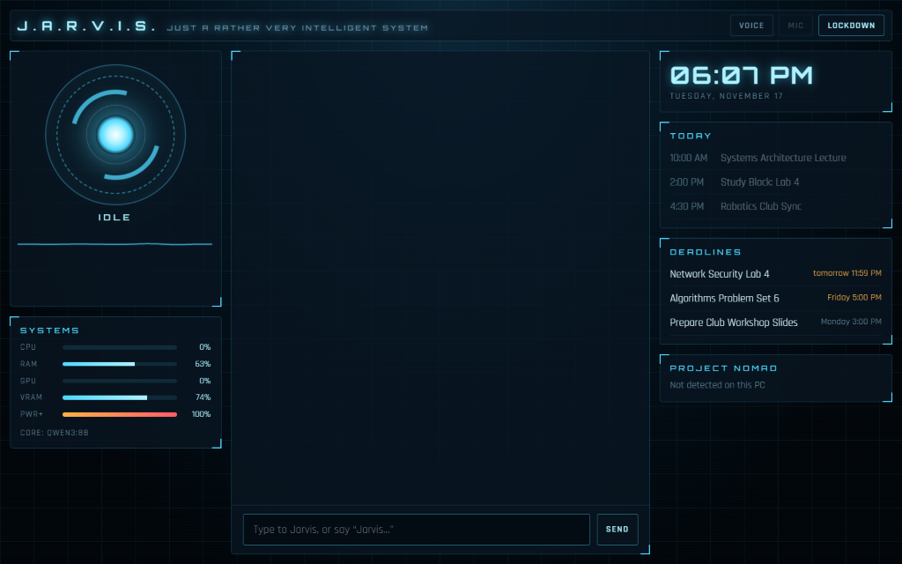 | 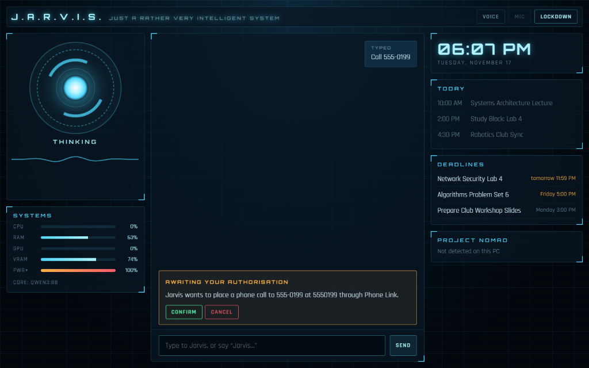 |

| Talk mode in Simple Light | Coding diff preview | Images panel |
|---|---|---|
| 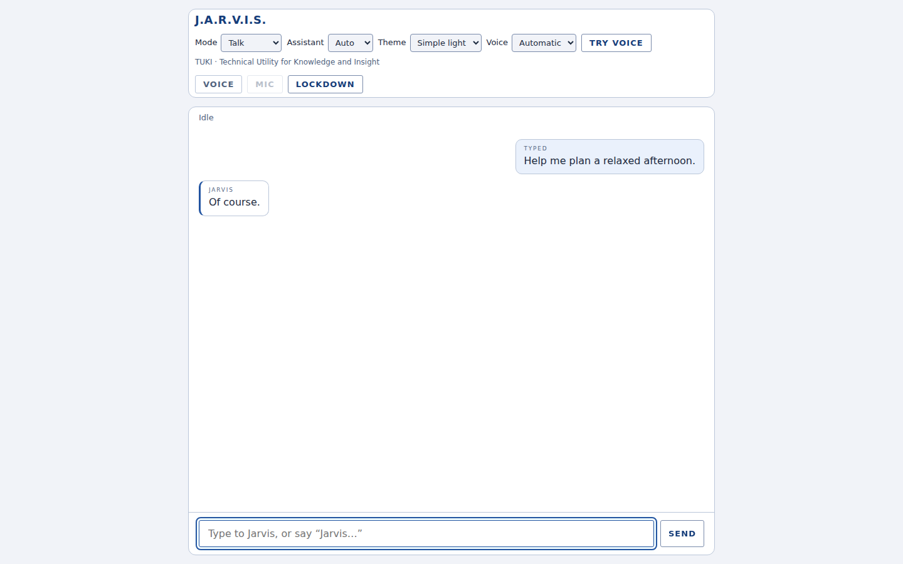 | 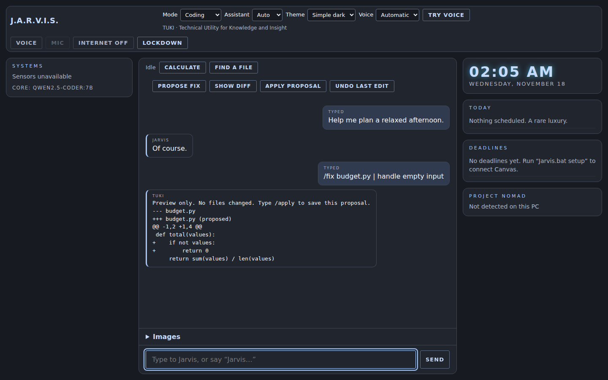 | 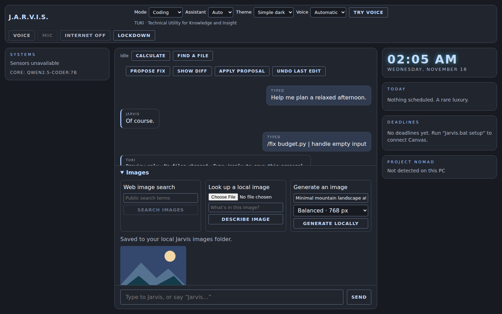 |

| Setup wizard | File tasks | Multi-file coding preview |
|---|---|---|
| 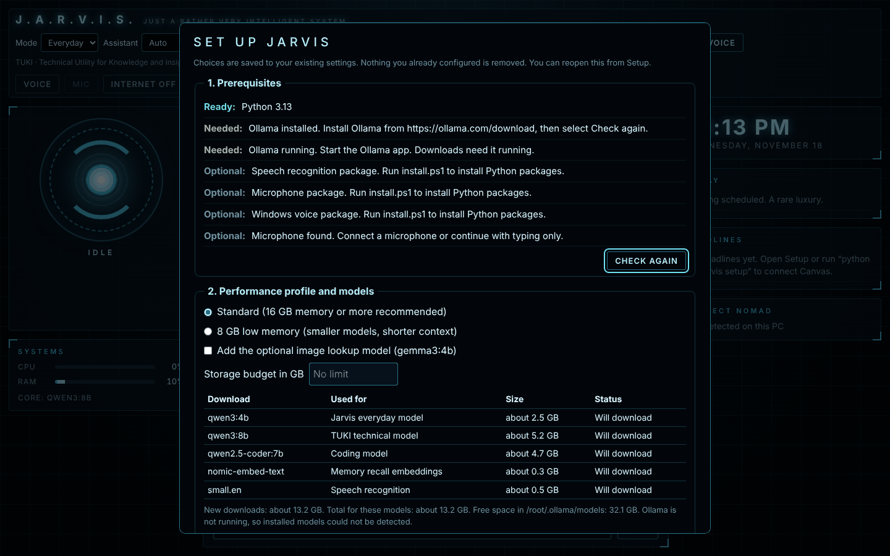 | 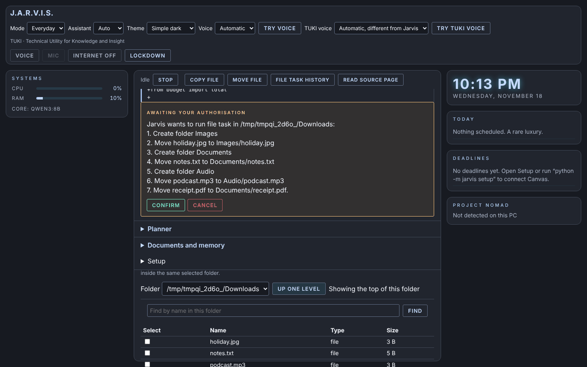 | 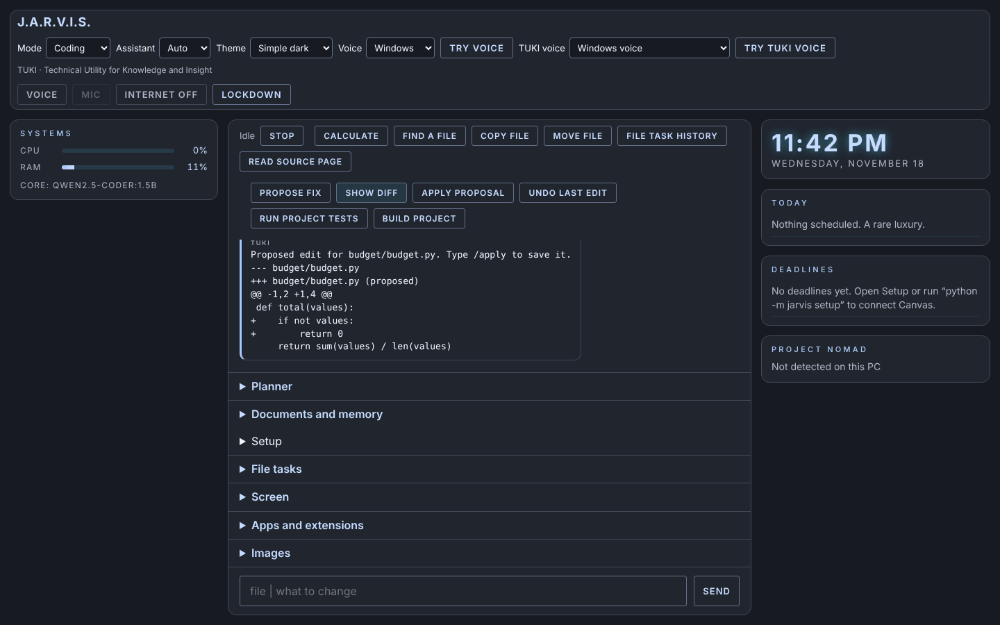 |

| TUKI voice and confidence | Themes: High contrast, Midnight, Paper | Phone-width layout |
|---|---|---|
| 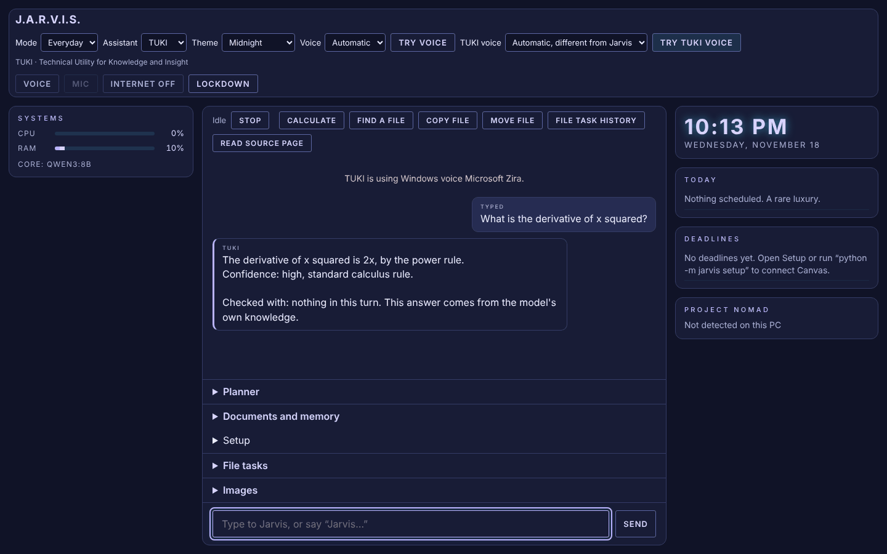 | 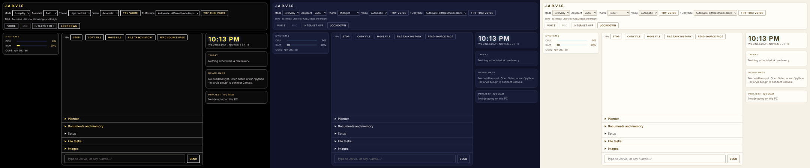 | 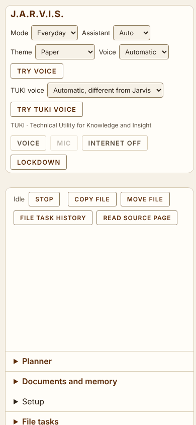 |

| Screen capture audit | App actions audit | Extension and OCR controls |
|---|---|---|
| 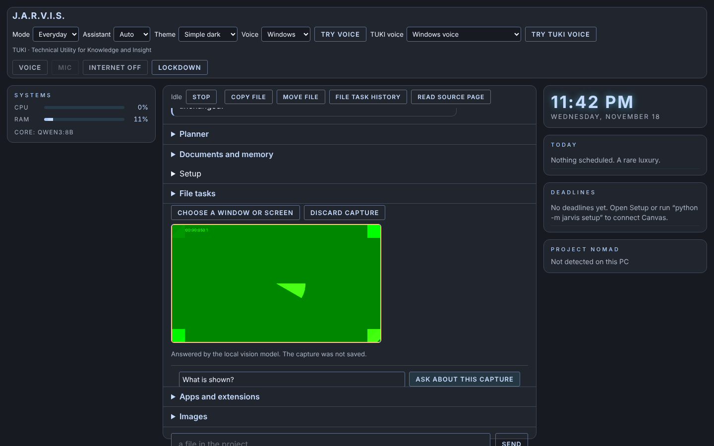 | 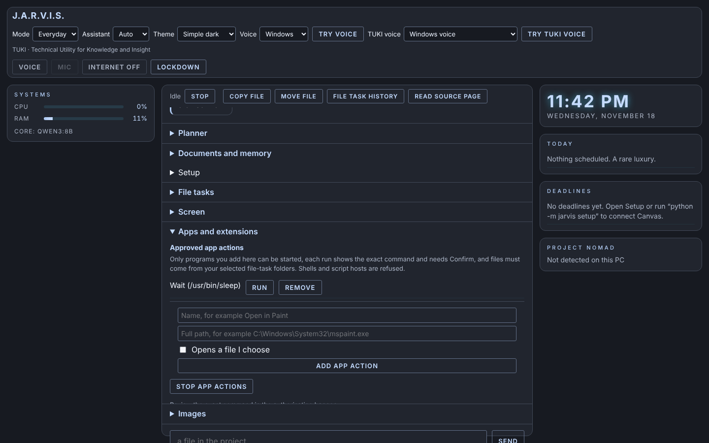 | [See the 54-control report](docs/ControlReport.md) |

Screenshots use synthetic conversation, sample files and stubbed model replies, captured by
`python -m scripts.capture_hud` and `python -m scripts.hud_control_audit`. The audit screen
image is a browser-generated test frame, not an example of real screen recognition.

## What it does

**Keeps your week on track**
- Reads Canvas through your private calendar-feed link, so no API key is needed. It keeps
  a copy, so it still works offline.
- Open the [weekly planner](#weekly-planner) to fit study blocks around your calendar
  and see how much time is missing before a deadline.
- A watchdog that runs in the background: a daily briefing, deadline warnings 24 hours
  and 3 hours ahead, heads-ups before events, and reminders.
- "What's falling behind?" shows anything overdue, due soon, or not planned yet.
- Exports everything to an `.ics` file for Google or Outlook calendar.

**Acts on your behalf, but safely**
- Email: Jarvis writes it and opens it in your mail app, and you press Send. Direct
  sending is optional.
- Calls and texts go through Windows Phone Link on your own phone. Jarvis can write
  talking points before a call.
- Contacts, so "text Mom" just works.

**Codes**
- Writes and fixes source files in `Documents\Jarvis Code` using a local Ollama coding model.
- Asks the model for focused edits (exact search and replace blocks) instead of whole-file rewrites.
  If its patch does not match, Jarvis asks for one repair; an invalid repair saves nothing.
- Previews changes to several files together: `/fix budget.py, helpers.py | change | rules.txt`.
  The model also sees a read-only list of the project's files and its test command.
- Checks Python, JSON and JavaScript syntax without running anything. Apply saves every file or none
  and keeps `.bak` copies. Undo restores all files from the last applied change if they are unchanged.
- `/test` shows the exact test command and runs it only after you confirm. `/fix-tests file` sends the
  failure output back to TUKI for a new preview. Generated code never runs without your approval.
- See the [Coding Guide](docs/Coding%20Guide.md) for a full example, checks, limitations and
  reproducible failure cases.

**Feels like the movies**
- Boot sequence, arc-reactor HUD, live CPU/GPU/RAM gauges, today's schedule, deadlines.
- Say "Jarvis" anywhere in a sentence, ask follow-ups, and it understands the
  conversation in the room. A British voice is used if Windows has one.

## Jarvis and TUKI

TUKI stands for Technical Utility for Knowledge and Insight. The HUD shows the full
name in the assistant controls. Choose Auto, Jarvis, or TUKI in the Assistant menu.
The mode and theme settings are separate.
Both assistants share the conversation and voice settings. The HUD shows who answered
and which local model handled the turn.

TUKI speaks with its own voice. With TUKI voice on Automatic, it picks an installed Windows voice
different from Jarvis's (for example Zira or Aria), or uses a Piper model set in
`python -m jarvis setup`. With only one Windows voice installed it uses that voice at a different
speed. Use **Try TUKI voice** to hear it and see which voice was chosen. TUKI's technical answers
end with a confidence line and what was checked in that turn, or a note that the answer comes from
the model's own knowledge.

| Assistant | Best for | Default Ollama model |
|---|---|---|
| Jarvis | Spelling, grammar, reading and summarising, and everyday conversation | `qwen3:4b` |
| TUKI | Source-backed fact-checking, maths, coding, and finding local files | `qwen3:8b`, with the configured coding model for edits |

In Auto, say “Jarvis, proofread this” or “Tuki, fact-check that.” You can type `Jarvis:` or
`Tuki:` to select one assistant for a message. Fact-checks that need live search show the
outbound query for approval, then show the returned sources and an assessment of their
search snippets. Read the original sources for details that the snippets cannot establish.

Try these in the HUD or terminal:

| Task | Example |
|---|---|
| Math | `/calc (12.5 * 3) / 4 + 2^8` uses the local arithmetic tool. Broader maths questions use the model for reasoning. |
| Coding | Switch to Coding mode and select Propose fix. Review the diff, then apply it or undo an edit from the HUD. |
| Fact-checking | Say “Tuki, fact-check that.” If an enabled search needs to go online, approve the displayed query and inspect the source links. |
| File search | `/files budget` finds matching filenames in your configured search folders (Documents, Desktop, and Downloads by default). |

Existing installs can run `ollama pull qwen3:4b` to add the everyday model. If that model
is missing, Jarvis temporarily uses the original main model until you install it and
restart. Both model choices are configurable with `everyday_model` and `model` in
`config.json`.

## Modes and themes

Use the Mode menu in the HUD or say “Jarvis, switch to Coding mode.”

| Mode | Behaviour |
|---|---|
| Everyday | General conversation and assistant tools. |
| Coding | Local coding model for file edits, diff/apply/undo, Git status, isolated worktrees, and approved tests/builds. |
| Research | Source retrieval, local/web comparison, contradiction checking, and explicit separation of verified facts from assumptions. |
| Cybersecurity | Defensive-only local security posture, Sentinel audit, and authorized NOMAD diagnostics. |
| Briefing | A shortcut to read your current briefing and a concise style for planning. |
| Talk | A chat-only view with no action tools or spoken background reminders. |

Choose a theme independently of the mode: Sci-fi HUD, Simple dark, Simple light, High contrast,
Midnight or Paper. The choice is saved. Every theme's text colours are checked automatically for at
least 4.5:1 contrast (7:1 for body text in High contrast). Use the Voice toggle to mute
responses, the Mic toggle to pause listening, and Try voice to hear a sample. Jarvis can use a
Windows voice such as George if installed, or a local Piper voice such as `en_GB-alan-medium`.
Set the local Piper model path in `python -m jarvis setup` and select Piper in the HUD.
The HUD can list installed system voices and select a named voice for Jarvis and
TUKI separately. Choose Automatic to restore the built-in preference order. A
named British voice appears only if it is installed in Windows. Try voice plays
a sample and reports the actual voice used; Piper selection uses the separate
local model paths in Setup.

`python -m jarvis --mode talk --theme simple` opens a minimal talk view. For coding, type
`/fix budget.py | handle empty input | rules.txt` to select a target and an optional related file.
Use `/diff`, `/apply`, or `/undo`, or the corresponding HUD buttons.

In Setup, choose the follow-up listening window (off, 8 or 20 seconds) and how much
nearby conversation Jarvis may keep as temporary context (off, 30 seconds or 2 minutes).
Turning context off or pausing Mic clears that temporary context. A paused mic discards
incoming speech; it does not close the operating system's input stream. Jarvis still
requires a wake word when follow-ups are off.

## Deliberate voice input and compact view

Choose Hold to record only in Voice input to disable wake-word and room processing.
Hold Hold to record, or hold Ctrl+Shift+Space while the HUD page is focused, then
release to transcribe locally. Recording ends automatically after 25 seconds.
Review and edit the transcript, then choose Use in message or Copy transcript.
Using a transcript fills an empty message box; select Send yourself. Existing text is
never replaced. Stop, Escape, losing page focus, or pausing Mic cancels an active capture.
Raw samples stay in memory and are discarded after transcription or cancellation.
The operating system input stream remains open while Mic is paused or manual input is idle.
This is a page shortcut, not a system-wide hotkey or automatic dictation into other apps.

Compact view hides the side dashboards and keeps conversation and approval controls
available. It is saved in this browser independently of mode and theme. Keyboard focus
outlines, a Skip to message link and reduced-motion support are included. This is a
compact browser layout, not a tray application or always-on-top native window.

## Local workflows and results

Open Local workflows and results, name a workflow, add up to ten steps and save it.
Supported steps search selected documents, read the saved schedule or open tasks,
review deadlines, and calculate arithmetic. Schedule values are `today`, `tomorrow`
or `week`. Task and deadline steps take no value. These steps do not contact online
services, change your files, or run model-generated code. Each run requires a full
step preview and confirmation. A tool configured to Ask or Off blocks the workflow;
run that step directly to use its individual approval flow.

Progress is saved after each completed step. Stop cancels at a checkpoint; an ongoing
local document read or OCR may finish before cancellation is observed. After a restart,
review and resume an interrupted run. Completed steps do not repeat. Inputs and up to
16,000 characters of redacted output per step stay in the local database, including
source file references returned by document search. Export results as JSON, or delete
saved runs. Up to 20 workflows and 50 runs can be kept. Exported files and older
backups remain until you remove them yourself. These are deterministic local workflows,
not autonomous specialist agents or scheduled external checks.

## Classic, Command Center and Ambient views

The View selector is independent of Mode and Theme. Classic Jarvis keeps the original
layout. Command Center adds quick navigation to planning, research, workflows,
connections and setup, using the same conversation, settings and backend data.
Ambient Intelligence shows an orbital core, actual processing state, optional clock,
active assistant color and microphone state. Open controls to return to Command Center.
Stop, Mic and Lockdown remain available. Pending action details, conversations and
schedules are visually hidden, including when Compact view was previously enabled.
This is glance privacy, not an operating-system lock: listening, speech and background
reminders keep their existing settings. Reduced-motion preferences stop the animation.

## GitHub issues

With Internet on and the configured repository token, use `/issues` for the first
page of open issues or `/issue 7` for one issue and up to ten comments. Reads require
approval. Use `/new-issue title | body` to draft an issue. Jarvis previews the complete
text and repository before sending; use Confirm or `confirm issue` to publish.
A changed repository invalidates the pending operation. Tokens need the corresponding
provider permissions, including Issues write only if you want issue creation. These
commands do not grant scopes or perform Git pushes or pull-request operations.
If the create response is lost, check GitHub before retrying; Jarvis makes no automatic
retry that could create duplicate issues. Real private-repository scopes remain unverified.

## Optional local chat provider

Ollama is the default. Setup also supports an explicitly selected loopback-only
chat-completions server, one exact local model ID, and a model-list check. Completed
replies and validated tool calls use the same permissions and confirmation controls.
The adapter uses keyword memory recall and has no cloud fallback. Its protocol tests
use a real loopback fixture; an actual inference server/model still needs verification.
See the [local provider guide](docs/Local%20Chat%20Provider.md) for setup and limits.

## RSS, Atom and US weather

With Internet on, use `/feed https://publisher.example/feed` to review up to twenty
RSS/Atom entries after approving the exact URL. Output retains source links and
feed-reported dates. Articles are not fetched, feed instructions cannot run tools,
and XML entity/DTD declarations are refused. This is a manual read; subscriptions,
background feed polling and automatic news briefings are not added.

Use `/weather latitude,longitude` for a supported US location. Jarvis previews the
coordinates and NWS service before making a points lookup and reading its forecast.
No GPS is accessed. The returned grid must remain on the approved `api.weather.gov`
forecast path. Temperatures, units, period times, source and update time come from
the response; missing readings are never replaced by demonstration data. See the
[NWS service documentation](https://www.weather.gov/documentation/services-web-api).
Live service availability and forecasts remain separate from the fixture tests.

## Weekly planner

Open Planner below the chat, enter a task, and select Plan my week. Choose View week
to see study blocks alongside your appointments and deadlines. These controls also
work when Ollama is stopped. They use the tasks and calendar events already on the PC,
including the last Canvas sync.

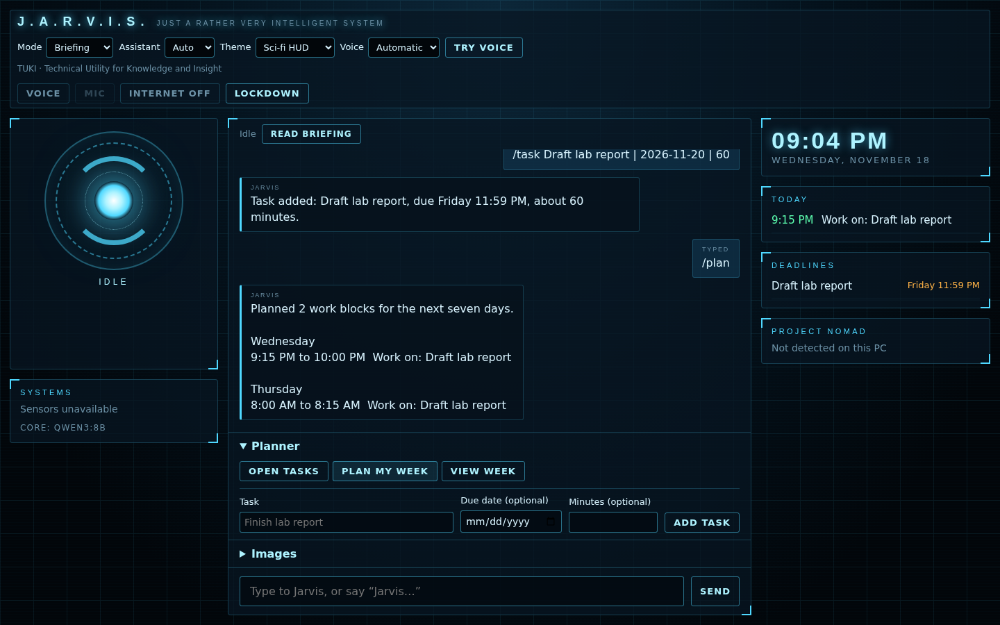

An all-day event appears on each date it covers. A calendar entry marked as free
stays visible and leaves that time available for study.

You can do the same from the HUD message box or from `python -m jarvis --text`.

| Command | Example |
|---|---|
| Add a task | `/task Finish lab report \| Friday @ 5 pm \| 60` adds an hour of work. The date and minutes are optional. A date without a time uses 11:59 pm. |
| List open tasks | `/tasks` |
| Build the next seven days | `/plan` |
| Read a schedule | `/schedule today`, `/schedule tomorrow`, or `/schedule week` |

Jarvis schedules the earliest deadline first. With the default 50-minute blocks,
a 60-minute assignment can fit into a free morning as 50 minutes, a five-minute
break, and 10 minutes. Planning again keeps blocks that already started and counts
their time toward the estimate. Marking the task complete is a separate action.

The planner flags work scheduled in the last 24 hours before a deadline. If you
prefer a two-day buffer, set `study_lead_hours` to `48` in
`%APPDATA%\Jarvis\config.json` and restart Jarvis. Set it to `0` to turn off
that notice. When the buffer is tight, the planner uses available time up to the
actual deadline and reports any minutes it still needs.

## Images

Open Images below the chat. It works in Everyday, Coding, and Briefing modes.
For an existing Windows installation, install the updated dependency from the
Jarvis folder with `.\.venv\Scripts\python.exe -m pip install -r requirements.txt`.

| Tool | What it does | Setup |
|---|---|---|
| Web image search | Shows Brave image sources and thumbnails when Brave's image proxy provides them. Jarvis shows the search terms for approval before sending them. | Configure Brave Search, then turn Internet on. |
| Local image lookup | Describe a PNG, JPEG or WebP or ask about its visible details. The selected image goes to Ollama on this PC. | Run `ollama pull gemma3:4b`, or configure another vision model in `vision_model`. |
| Local generation | Sends a prompt to your local Stable Diffusion backend. Choose Draft, Balanced, or High and download the PNG from the HUD. | Run [Stable Diffusion WebUI](https://github.com/AUTOMATIC1111/stable-diffusion-webui/wiki/API) with its API enabled, load a checkpoint, and enter `http://127.0.0.1:7860` as the generation API URL in `python -m jarvis setup`. |

Local lookup and generation work with Internet off after you install the model and
backend. Image lookup describes a selected image. Web image search searches by
the text you enter. Generated PNGs are also saved in `%APPDATA%\Jarvis\images`.

For a lower-memory machine, start with Draft (512 px). High uses 1024 px and
more sampling steps. Visual quality and speed depend on the loaded checkpoint and
your hardware. Check the source and its usage terms before reusing a search result.

## Optional online tools

Jarvis starts offline. Run `python -m jarvis setup` from the Jarvis folder to configure the services you want.
Keys are entered through hidden prompts and stored with Windows DPAPI.

- [Brave Search](https://api-dashboard.search.brave.com/) provides public web results.
  Ask for a web search or type `/search your query`. Confirm the outbound search terms
  to get source links in the HUD. Only approved search terms are sent to Brave.
- [GitHub uploads](https://docs.github.com/en/rest/repos/contents#create-or-update-file-contents)
  can add a selected file to `uploads/` in one configured repository and branch. Use a
  repository-scoped token with Contents write permission. Type `/upload report.pdf` with
  the file in your Jarvis Code workspace. Jarvis shows the path, size and destination before
  confirmation. Each upload can create a commit and be visible to anyone with repository access.
  Uploads are limited to supported files up to 5 MiB. Existing paths are rejected.
- Use the Internet toggle in the HUD to turn online tools on or off. Lockdown blocks
  searches and uploads, including requests that were already waiting for confirmation.

## Security
- **Nothing happens without your "yes":** calls, texts, sending email, running code,
  shutting down, and emptying the Recycle Bin all show exactly what will happen and wait
  for you to say yes or click Confirm.
- **Hidden-instruction screening:** Jarvis treats text from files, Canvas and the library as untrusted. It checks for known instruction patterns and blocks content when the checks flag it.
- **Encrypted secrets:** your Canvas link, token and email password are locked to your
  Windows account (DPAPI). They're never stored in plain text.
- **This PC only:** the HUD listens only on 127.0.0.1, needs a per-session key, and
  rejects other websites and spoofed hosts.
- **Code workspace:** Jarvis confines its file editing tools to the configured code
  folder. Python and JavaScript runs have a 60-second timeout.
- **Audit log:** every outside action is recorded in `%APPDATA%\Jarvis\actions.log`.
- Passwords, card numbers and SSNs are scrubbed before anything is saved to memory.
- Offline by default. Internet tools are off unless you turn them on, and every outbound
  request goes through a fail-closed central allowlist.
- **Lockdown mode & per-skill permissions:** one-click **Lockdown** button on the HUD
  disables all risky skills immediately; `skill_permissions` in `config.json` can disable
  or require confirmation for any skill (risky skills can never bypass confirmation).
- **Execution limits:** outbound calls, texts, and emails are rate-limited. For Python
  and JavaScript runs, Jarvis strips environment variables, blocks common networking
  APIs, and attempts to apply Windows Job Object limits. Approved scripts run under
  your Windows account with its permissions. Review generated code before running it.

## License

Licensed under the [Apache License 2.0](LICENSE).

## Install (once)

1. Install [Python 3.12](https://www.python.org/downloads/) with "Add Python to PATH", and
   [Ollama](https://ollama.com/download).
2. Download the packaged ZIP and checksum from [Releases](https://github.com/test3457890/Jarvis/releases). Verify the ZIP using the published SHA-256, then extract it to a short path such as `Documents\Jarvis`. Windows can't load some of
   the voice libraries from very long paths.
3. In that folder run:

```powershell
powershell -ExecutionPolicy Bypass -File install.ps1
```

This creates the Python environment, installs packages and adds a **Jarvis** Start menu shortcut and a
**Start Jarvis** shortcut in the folder. The shortcuts start `.venv\Scripts\python.exe -m jarvis`
directly. There is no batch file. If you prefer PowerShell, run this from the Jarvis folder:

```powershell
& .\.venv\Scripts\python.exe -m jarvis
```

Options: `-Profile low-memory` saves the 8 GB profile, `-DownloadModels` downloads models in the
script instead of the wizard, `-DesktopShortcut` adds a desktop shortcut, `-NoShortcut` skips them.
Running `install.ps1` again repairs the install and keeps your settings.

The release is not code-signed. If Microsoft Defender or SmartScreen reacts to the download, see
[docs/WindowsDefender.md](docs/WindowsDefender.md). Do not disable Defender or add exclusions.

## First launch setup wizard

The first time Jarvis starts, the HUD opens a setup wizard. Reopen it later from Setup.

- **Prerequisites:** Python, Ollama installed and running, speech and microphone packages, microphone.
- **Profile and models:** Standard or 8 GB low memory, an optional image model, each download's
  approximate size, whether it is already installed, and free space on the model drive.
- **Storage budget:** enter a limit in GB. Jarvis warns and asks before starting downloads above it.
  Ollama and the speech model cache are shared by every app on the PC, so Windows cannot give Jarvis
  a hard per-app limit there. Jarvis checks the budget before each download starts.
- **Voice, folders, coding workspace and online tools.**

Downloads run in the background. If one fails, select **Resume setup**. Completed models are kept and
Ollama resumes partial downloads. The wizard merges your choices into existing settings. It never
erases your configuration. Existing installs are not interrupted by the wizard after upgrading.

## Low-memory setup

For an 8 GB PC, run the installer with the low-memory profile.

```powershell
powershell -ExecutionPolicy Bypass -File install.ps1 -Profile low-memory
```

This selects smaller chat and coding models, a shorter context, base.en speech recognition,
and keyword memory recall. Chat models unload after each reply. This can reduce retained
memory and adds model loading time on the next reply. Performance depends on your PC.

Choose the profile in the setup wizard, or switch with
`python -m jarvis --text --profile low-memory` after downloading those models. Use
`--profile standard` to restore the larger defaults. Profiles preserve your personal settings
and select their own model names. Restart Jarvis after changing a profile through setup.

See [AGENTS.md](AGENTS.md) for known limitations and next tasks, and
[docs/Benchmarks.md](docs/Benchmarks.md) for benchmark status. No 8 GB Windows benchmark has been
recorded yet, so no speed or quality improvement is claimed.

## Use
Use the **Jarvis** Start menu shortcut for voice plus the HUD. From the Jarvis folder in PowerShell,
`python` below means `.\.venv\Scripts\python.exe`.

| Command | What it does |
|---|---|
| `python -m jarvis` | Voice plus the HUD (what the shortcut runs) |
| `python -m jarvis setup` | Your name, Canvas link, email and API keys (encrypted), voices |
| `python -m jarvis --text` | Type in the terminal |
| `python -m jarvis doctor` | Check hardware, GPU/RAM profile recommendations, models, and voice packages |
| `python -m jarvis security-audit` | Run the local defensive Sentinel security posture audit |
| `python -m jarvis voice-check` | Record four seconds after you press Enter, show the local transcription, and play a test reply. Confirm the speaker worked by listening. |
| `python -m jarvis briefing` | Hear today's briefing |

Try saying: "Jarvis, plan my week." "What's falling behind?" "Email Professor Lee
asking to move our meeting to Thursday afternoon." "Text Mom I'll be home at 6."
"Write a Python script that renames my photos by date." "Look up how to treat a
sprain in the library."

**Connecting Canvas:** in Canvas open **Calendar**, click **Calendar Feed** (bottom
right), copy the link, and paste it into `python -m jarvis setup`.

**Phone calls and texts:** set up the **Phone Link** app with your phone once.

## Project NOMAD integration

[Project NOMAD](https://github.com/Crosstalk-Solutions/project-nomad) is a separate,
optional server. It hosts the offline content you download. Jarvis can search its
Kiwix library, read an excerpt from a matching article, and use that excerpt in a reply.
Jarvis can also open installed NOMAD services such as maps, education, or notes in
your browser. The HUD's Project NOMAD panel shows which default service ports respond.

### Connect Jarvis to NOMAD

1. Start NOMAD and install the Kiwix service and at least one searchable content
   pack in the NOMAD Command Center.
2. On the PC running Jarvis, open the NOMAD Command Center and Kiwix in your browser.
   With default ports, they use `:8080` and `:8090` respectively.
3. If both are on the same machine and reachable over loopback, use the defaults.
   If NOMAD runs on another machine, set `nomad_url` in
   `%APPDATA%\Jarvis\config.json` on your PC to the NOMAD server's own IP address
   or hostname, followed by its Command Center port. Replace `NOMAD_HOST` below
   with the address assigned to your NOMAD server. Keep the real address in your
   local settings. The repository contains only this placeholder.

   ```json
   {
     "nomad_url": "http://NOMAD_HOST:8080",
     "kiwix_url": ""
   }
   ```

   Leave `kiwix_url` empty to search port `8090` on the same host. If your Kiwix
   service uses a different URL, set `kiwix_url` to that service's base address.
4. Restart Jarvis and run `python -m jarvis doctor`. Try “Jarvis, search the offline library
   for how a compass works” or “Jarvis, open NOMAD maps.”

NOMAD library queries go directly to the configured Kiwix server and work with
Jarvis's Internet toggle off. A NOMAD server on a second machine still needs a reachable
local network connection. Search coverage and freshness depend on your downloaded
content. Jarvis and Tuki continue to use the Ollama server set in `ollama_url`,
which is separate from the NOMAD connection.

## Verify an installation

Run `python -m jarvis doctor` after setup to check the models and voice dependencies.
On Windows, try both assistants from the HUD, use Try voice, and say a wake word.
Verify any enabled online service with a public test query or a throwaway file.

The GitHub test workflow runs `python -m pytest -q` on both Windows and Linux.
It uses mock responses for online services and tests native DPAPI on Windows.

## Inspired by (ideas re-implemented, no code copied)
[CS50 Jarvis](https://github.com/diegofcn/Jarvis-CS50-Final-Project) ·
[OpenJarvis](https://github.com/open-jarvis/OpenJarvis) ·
[isair/jarvis](https://github.com/isair/jarvis) ·
[PersonalJarvis](https://github.com/tbckdev/PersonalJarvis) ·
[OpenDex](https://github.com/wassgha/opendex) ·
[Project NOMAD](https://github.com/Crosstalk-Solutions/project-nomad)


## Document search and remembered facts

Choose document folders in the setup wizard (or `python -m jarvis setup`). Open Documents and memory
below the chat to search their contents, or type `/docs compass navigation`. Text and Markdown
results cite line ranges, PDFs cite pages, and Word files cite paragraphs or tables. Word page
numbers depend on layout, so paragraph references are used. Scanned PDFs require OCR before
text search. Install the updated requirements to add the PDF and Word readers.

Search reads current files on each request and returns up to six excerpts. Each request covers
up to 200 documents, 3,000 directory entries, 200 PDF pages per document, and 500,000 extracted
characters per document. Files larger than 10 MiB and unreadable files are skipped. Narrow the
selected folders if the search limit is reached. Document search works locally with Internet off.

Setup also offers an optional local document index. When enabled, `/docs` updates changed
documents before searching, retains extracted text from selected folders in
`%APPDATA%\Jarvis\documents-index.sqlite3`, and removes deleted files from results.
Changing document folders or turning the index off deletes the index file. The indexed
search still obeys the existing folder, file count, file size and extraction limits.

Use `/research-docs your question` or **Research selected docs** under Documents and
memory to compare matching excerpts with the local model. The response includes the
original numbered file and section excerpts for checking. If the model is unavailable,
Jarvis shows the excerpts without a summary. This reads only selected local folders;
the existing `/check` command handles explicitly approved public web sources.
Use `/research-all your question | https://source-one | https://source-two` to
compare selected local excerpts with one to three public pages. Jarvis asks for
URL approval before reading pages, then searches selected folders locally. The
response shows both sets of evidence. This requires online tools and local
document search to be enabled. Local excerpts are sent only to the configured
local Ollama model, not to the public pages.

Under Documents and memory, add a daily document check with a query and local time.
Checks run while Jarvis is open, over only the document folders you selected. The first
run records matching excerpts without notifying; later runs notify when those matches
change. Pause, resume, or delete each check in the same panel. The last run and status
are saved locally in `memory.db`. If Jarvis is closed at the scheduled time, the check
runs after it is next opened that day; paused checks never run. A document that trips
the instruction injection screen does not generate a change notification. Search
permissions set to Ask or Off prevent unattended checks.

Use Review remembered facts to edit or delete individual facts. Deletion requires confirmation.
The memory list also shows when each fact was saved and whether it came through Jarvis's
memory tool or predates source tracking. Set an expiration date for a fact, or choose
Never expire. While Jarvis runs, expired facts are deleted from local storage and are
excluded from recall. Expiration is checked on startup, when facts are accessed, and
by the background watchdog. Choose a future date on this computer's local clock.
Export remembered facts downloads a JSON copy to your browser's download folder. These controls
manage remembered facts. The saved conversation history is separate, and prior conversation
can still contain a fact you deleted. Backup, restore, and conversation deletion are available in the same panel.

## Activity timeline

Open Activity timeline in the HUD to review up to 50 recent local actions and blocked
requests. The view shows a time, action, limited target and an undo hint when one
applies. It does not display raw message bodies, source excerpts, tool results or
secrets. Jarvis keeps the local `actions.log` for troubleshooting; newly logged
approved tools record field names instead of raw arguments and results. Existing
older log entries are not rewritten, so review the file itself before sharing it.

## Connection center

Open Connections in the HUD to review the built-in Canvas, Brave, GitHub upload,
SMTP email, Project NOMAD and local image generation settings. The panel reads
local configuration and whether credentials are saved; it does not test the
remote service or reveal credentials. It shows each service's current scope and
the command to reconnect through setup. For credential-backed services, Remove
saved credential requires an explicit confirmation and disconnects Jarvis locally.
It does not revoke the credential with the provider. Removing the Canvas feed
credential also clears its local calendar cache; previously imported tasks and
events remain until you manage them separately. The Internet toggle pauses
Brave and GitHub tools, while Canvas sync and approved SMTP use their own controls.

## Local model inventory

Setup can show Ollama's installed local models and their reported disk sizes.
Choose an installed model for Everyday, TUKI technical, or Coding mode; Jarvis
does not download or run a model merely to list it. The performance profile and
configured context length are shown alongside the inventory. Disk size is not a
RAM estimate or speed measurement, and Jarvis cannot guarantee that a selected
model supports every role. The first-run wizard can reset these choices when a
performance profile is reapplied.

## Daily briefing controls

In Setup, choose the daily briefing time, turn the automatic briefing on or off,
and decide whether it is spoken. Jarvis shows the digest once per local day while
it is open, after the chosen time. If it was closed at that time, the briefing
appears when it next opens that day. The Read briefing button replays it on demand
outside Talk mode; the Speak setting controls the automatic briefing only.

## Investigate a test failure

After an approved `/test` fails in Coding mode, use `/investigate-tests` or
Investigate failure. Jarvis extracts the error lines and likely files inside the
selected coding workspace from the saved test output. This review runs no command
and makes no edits. Choose the intended file with `/fix-tests file | intended
behavior`, review `/diff`, and apply only if the proposal is correct. A passed
test, cancelled approval, or workspace switch cannot be used as an old failure.

## Existing Git repository in Coding mode

In Setup, choose an existing local Git repository as the Coding mode workspace. Jarvis
lists bounded project files and detected test commands without running Git. Coding
edits are confined to that selected folder, reject links and `.git` metadata, and
still need full diff review and Apply. Tests and builds require confirmation of the
detected command. Use Jarvis Code folder to return to the default workspace; undo
records are kept separately for each workspace. This does not clone, commit, push,
or upload the repository.

## File tasks in selected folders

Open **File tasks** below the chat. It works only inside folders you chose for file tasks in the
setup wizard, and never inside the Jarvis Code workspace.

- Browse folders, find files by name, then select items.
- Create a folder, rename, copy files, move items, delete (recoverable), or organise a folder into
  Images, Documents, Audio, Video, Archives, Code and Other.
- **Preview changes** lists every step exactly. Nothing changes until you select Confirm.
- Existing files are never overwritten. Paths with `..`, drive letters, device names, links or
  junctions are refused.
- Deleted items move to a `.Jarvis Recycle` folder inside the same selected folder. Remove that
  folder yourself in Explorer when you no longer need it.
- Each step is saved in a task journal. After a failure, a permission error, Stop or a restart,
  use **Show task history** to resume or undo. Undo checks every result first and is refused if
  anything changed since the task ran.
- Limits: 500 steps per task, 512 MiB per copied file, 2 GiB copied per task, 500 items listed.

## Streaming, source pages and workspace file tasks

Reply drafts stream into the HUD. Stop or Escape cancels the active reply and clears pending
approvals. Talk mode speaks completed sentences as they arrive. Action modes speak after
completed tool processing. Speech stops at a worker checkpoint. A network request may remain
pending until it receives another chunk or times out. Completed actions can be reviewed separately.

Use `/read https://example.org/page | the claim to check` to request source-page evidence.
Jarvis shows the URL for approval. Type `confirm source` or use Confirm. Reads accept public
HTTPS HTML or text pages. A redirect needs separate destination approval. Evidence extraction
covers up to 12,000 characters from a page up to 1 MB. Use `/check https://source-one | https://source-two | claim` to approve and compare
up to three source pages in one assessment. Extracted excerpts are shortened to fit your context. The quoted passages let you check the assessment against the source text.

If a GitHub repository and token are configured in Setup, `/repo` requests approval
to read that repository's metadata and README through GitHub's API. It shows the
first 12,000 README characters. The command makes GET requests only and does not
run code or change the repository. It works for a private repository when the
configured token has read access. The repository text is treated as untrusted.

Use `/copy original.txt | copy.txt` or `/move original.txt | moved.txt` for files inside
Jarvis Code. Confirm the preview. `/jobs` shows the persistent task journal. `/resume JOBID`
requests approval to continue an interrupted task. `/undo-file JOBID` requests approval to
reverse a completed task. Changed files block undo. Destination folders must already exist.
Tasks support files up to 5 MiB and publish new destinations without overwriting existing files.

## Setup, backup and releases

The Setup panel changes the performance profile and document folders. Install missing models
with the command shown after saving. Restart Jarvis for speech-model changes.

Documents and memory includes Clear conversation history, Back up local data, and Restore
backup. Restore validates the database, saves a rescue snapshot and replaces local database
contents transactionally. Backups include conversations, facts, reminders, tasks, events,
contacts and file-task journals. They are local unencrypted database copies. Keep them private.
Deleting live data leaves existing backups available until you remove those backup files.
Configuration and encrypted credentials have their own files and are outside these snapshots.

Versioned source packages are published in [Releases](https://github.com/test3457890/Jarvis/releases)
after the main-branch test workflow succeeds. Verify the ZIP using the SHA256SUMS.txt value.
Close Jarvis and run the updater from your existing program folder.

```powershell
powershell -ExecutionPolicy Bypass -File upgrade.ps1 -Package "C:\Downloads\Jarvis1.3.0.zip" -Checksum "PASTE_SHA256_VALUE"
```

The updater replaces only shipped program files. Settings, data, credentials, `.venv` and models are
left alone. An old `Jarvis.bat` stays in place but is no longer needed. Run `install.ps1` afterwards
to refresh packages and create the shortcut.

The updater reports the program-backup folder. Restore those shipped files when needed.

```powershell
powershell -ExecutionPolicy Bypass -File upgrade.ps1 -Restore "PASTE_PROGRAM_BACKUP_FOLDER"
```

Source recovery restores shipped program files. Python packages and Ollama models have their
own installation state. Run install.ps1 after updating to refresh dependencies,
then run `python -m jarvis doctor`. The ZIP contains source. Python, Ollama, speech models and optional
image-generation backends require installation.

Run `python -m scripts.benchmark` in the installed environment to record real model timings
and the tested hardware configuration. `--audio recording.wav --expected "Jarvis read my briefing"`
also measures transcription error rate for that labelled recording. Reports are saved locally.


## Screen, app actions, OCR and extensions

- **Screen:** open **Screen**, select **Choose a window or screen**, and pick one in your browser's
  sharing dialog. Jarvis keeps a single still image, stops sharing straight away and shows it. Ask a
  question to send it to the local vision model (`vision_model`, for example `gemma3:4b`). Nothing is
  captured without that dialog, and captures are not saved.
- **App actions:** in **Apps and extensions**, add a program by its full path, for example Paint.
  Shells and script hosts such as PowerShell or Python are refused. Each run shows the exact command
  and waits for Confirm. **Stop app actions** closes what Jarvis started. Files must come from your
  selected file-task folders.
- **OCR:** install [Tesseract OCR](https://github.com/UB-Mannheim/tesseract/wiki), then tick the OCR
  box in Setup. Document search then reads scanned PDF pages and PNG, JPEG and TIFF images on this PC.
- **Extensions:** see [docs/Extensions.md](docs/Extensions.md). Extensions stay off until you enable
  them and approve the permissions they declare.

## What is in this repository

Some people ask about Jarvis "containers". This repository has **no Docker or other containers**.
Jarvis runs as one Python process on your PC. What exists:

| Component | What it is | Where |
|---|---|---|
| HUD panels | Sections of the browser page: Planner, Documents and memory, Setup, File tasks, Images, the setup wizard and the confirmation banner | `jarvis/ui.html` |
| Controls | Mode, Assistant, Theme, Voice, TUKI voice, Try voice, Voice, Mic, Internet and Lockdown toggles, Stop | `jarvis/ui.html`, `jarvis/__main__.py` |
| Assistants | Jarvis (everyday) and TUKI (technical), routed per message | `jarvis/assistants.py`, `jarvis/brain.py` |
| Tools | Planner, email, calls, texts, documents, files, coding, search, images, NOMAD | `jarvis/skills.py` and modules listed in [AGENTS.md](AGENTS.md) |
| Coding workspace | The only folder coding tools may edit | `Documents\Jarvis Code` |
| Project NOMAD | A separate, optional offline server you install yourself. Its own installer runs its services. Jarvis only checks its ports and searches its Kiwix library | `jarvis/nomad.py` |

Planned, not implemented: code signing, an MSI or MSIX installer, Windows Recycle Bin integration,
and spoken interruption while Jarvis is speaking.
