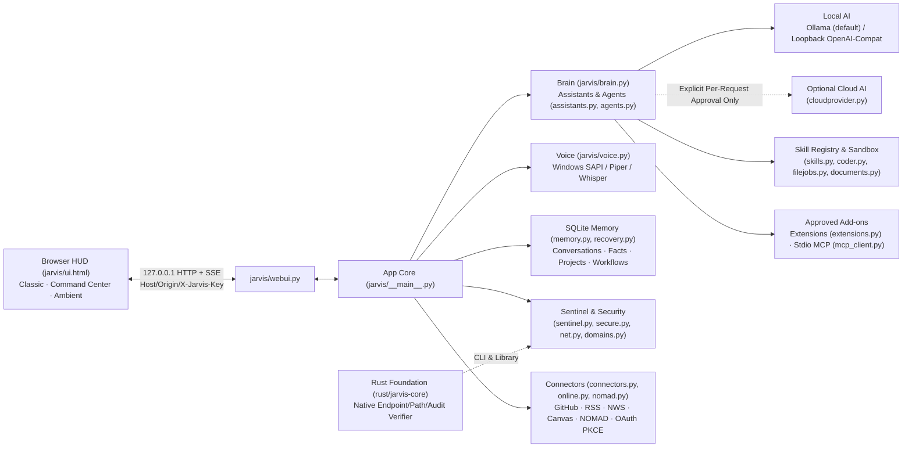

# Jarvis Architecture

## Overview

Jarvis is an offline-first local AI assistant designed primarily for Windows 10/11 (with Linux compatibility for development and testing). It runs as a single local Python process serving an authenticated browser HUD strictly on `127.0.0.1`, paired with an optional native Rust policy/audit foundation crate (`rust/jarvis-core`).

## Core Subsystems

1. **Local Intelligence & Model Providers (`brain.py`, `localprovider.py`, `cloudprovider.py`, `hardware.py`)**
   - Default inference uses local Ollama (`/api/chat`, `/api/embed`, `/api/tags`) with role-specific models (`everyday_model`, `model` for TUKI, `coder_model`, `embed_model`, `vision_model`).
   - Optional numeric-loopback (`127.0.0.1`) OpenAI-compatible provider supports completed replies, strict tool-call validation, optional SSE streaming, and optional DPAPI-stored Bearer authentication.
   - Optional cloud providers (`OpenAI`, `Anthropic`, `Gemini`) are off by default, never used as silent fallback, and enforce mandatory per-request user confirmation.
   - `hardware.py` inspects real CPU cores, RAM, disk space, and NVIDIA GPU VRAM (`nvidia-smi`) to recommend `standard` vs `low-memory` profiles honestly.

2. **Multi-Agent Intelligence (`assistants.py`, `agents.py`)**
   - Preserves Jarvis (everyday assistant) and TUKI (`Technical Utility for Knowledge and Insight`) with distinct voices, prompts, and uncertainty/evidence labeling.
   - Adds specialist agent profiles (`jarvis`, `tuki`, `researcher`, `coder`, `planner`, `reviewer`) with bounded step counts, recursion depth limits (`MAX_DELEGATION_DEPTH = 2`), memory scope controls, and Jarvis+TUKI cooperative independent review (`assistant="both"` or `/review`).

3. **Memory, Knowledge & Conversations (`memory.py`, `documents.py`, `docindex.py`, `recovery.py`)**
   - Local SQLite database (`%APPDATA%\Jarvis\memory.db`) stores named conversations, messages, remembered facts with provenance & expiry, projects (knowledge spaces), reminders, tasks, calendar events, daily document watches, and workflow runs.
   - Temporary chat mode keeps turns strictly in memory without persisting to SQLite.
   - Duplicate fact detection, deduplication, redacted JSON import/export, and transactional backup/restore with rescue snapshots protect user data.
   - Optional FTS5 document index (`documents-index.sqlite3`) stays opt-in and deletes itself when turned off or when document folders change.

4. **Connectors, Workflows & MCP (`connectors.py`, `online.py`, `workflows.py`, `mcp_client.py`, `extensions.py`)**
   - Fail-closed outbound allowlist (`net.py`) with public-IP-pinned no-redirect HTTPS reader for approved pages, RSS/Atom feeds, and NWS weather forecasts.
   - GitHub integration supports approved repository/README reads, open issues, issue comments, explicit drafted issue creation, open pull request lists, and manual file uploads.
   - PKCE OAuth 2.0 scaffolding (`connectors.py`) separates read-only and write scopes for Google Workspace and Microsoft 365 without claiming live account access until user credentials are configured.
   - Stdio JSON-RPC 2.0 MCP client (`mcp_client.py`) requires explicit per-server capability approval before discovery or execution and fences all tool output against prompt injection.

5. **Desktop, Server, Mobile & Rust Foundation (`rust/jarvis-core`, `install.ps1`, `upgrade.ps1`, `webui.py`)**
   - **Desktop**: Direct Windows Start Menu & folder shortcuts launch `.venv\Scripts\python.exe -m jarvis` without batch files.
   - **Server & Remote Access**: Bound strictly to `127.0.0.1` by default. Remote or mobile companion access is intentionally NOT exposed on LAN/public interfaces automatically; any future remote access must run behind an authenticated local reverse proxy or VPN tunnel (such as Tailscale/WireGuard) with TLS and dedicated auth tokens.
   - **Rust Foundation**: `rust/jarvis-core` provides a zero-dependency native Rust library and CLI for deterministic endpoint validation, workspace path-traversal checks, and `actions.log` audit verification.

6. **Finance & Health Boundaries (`domains.py`)**
   - Protected domain guards keep finance and health integrations disabled by default and prohibit write operations in this release.
