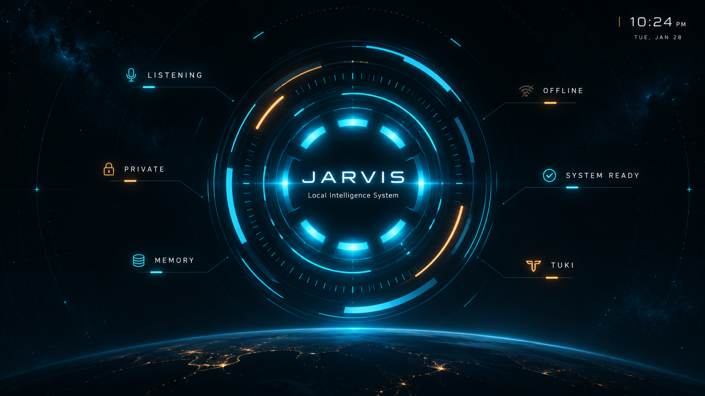
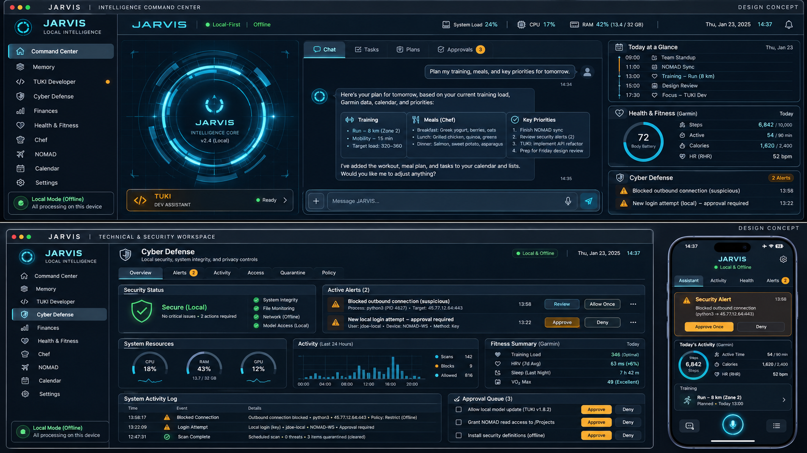
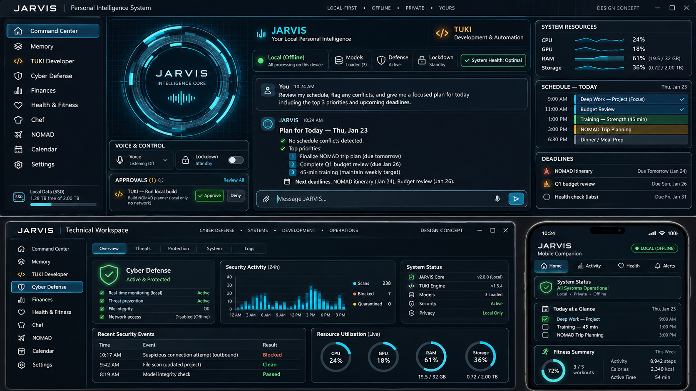

# Jarvis design references

These are the three original generated concepts. They are concept art, not screenshots of implemented behavior. The pictured financial, Garmin, cyber-defense and mobile data are illustrative; those integrations must not be inferred from these images. All legacy application screenshots remain in the [screenshot gallery](../screenshots/README.md).

The current Classic, Command Center and Ambient browser views share one backend. Command Center and Ambient are initial implementations of these directions, not pixel-for-pixel copies of the artwork. Their actual synthetic-data UI captures are produced by the GitHub CI HUD audit as `audit-phase2-command.png` and `audit-phase2-ambient.png`.

## Ambient orbital core concept

## Command Center concept

## Local intelligence dashboard concept

## Source integrity

The original WebP bytes are preserved without modification.

| File | SHA-256 |
|---|---|
| orbital-intelligence-core.webp | 42e4ba765e964874f96ee256792afc09ad686951ddbbed1ebf0b8e2f7a518016 |
| command-center-concept.webp | 787dc4e24d3f12f2c7feea187b1f235c6893a41b7838b13def83a6f2d80ce227 |
| local-intelligence-dashboard.webp | 80a16d5b96676e42ebfe5ac1f42905b2f587136f7adbbdf739f113f049ca8c2a |
